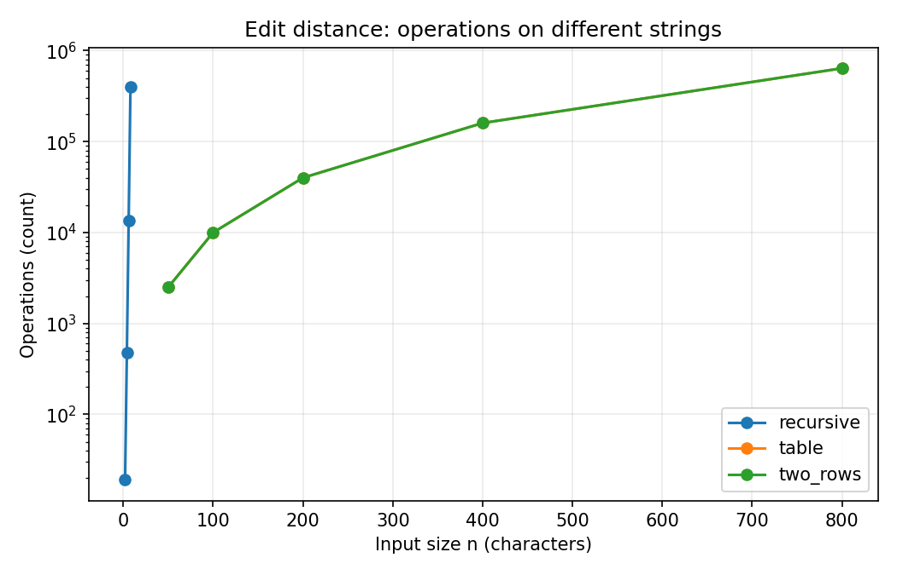
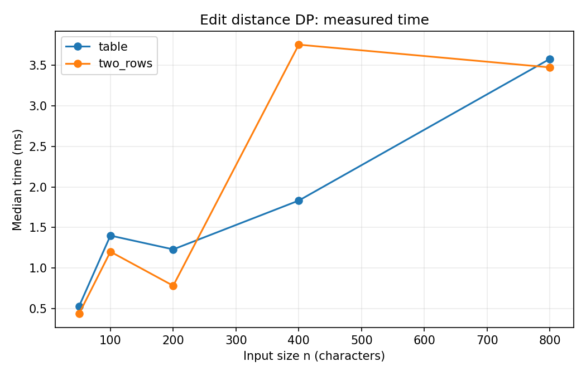
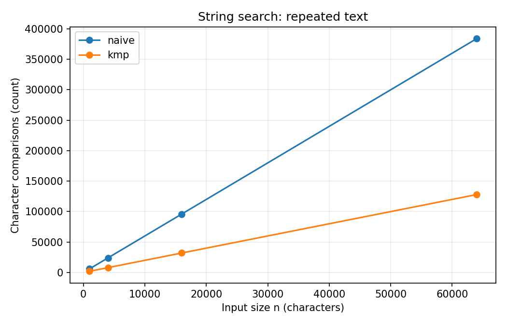

# Assignment 4 - Dynamic Programming and String Algorithms

## Experiment Design Card (written before running)

| Field | My plan |
|---|---|
| Question | Edit distance: how much does the cost grow when the words get longer? Search: when is KMP better than Naive? |
| Sizes | Recursive: 2, 4, 6, 8 (recursion gets slow). DP: 50, 100, 200, 400, 800. Search: 1000, 4000, 16000, 64000. Each family has at least four sizes and largest >= 4 times smallest. |
| Inputs | Edit: seeded random strings and completely different strings (all A versus all B). Different strings make recursion explore many branches. Search: seeded random text and repeated A text with pattern AAAAAB. Repeated text makes Naive almost match at every position. |
| Metrics | Time in milliseconds for each of five runs; use median in charts. Edit counter: recursive calls or DP cells updated. Search counter: character comparisons, including KMP prefix preprocessing. These count actual algorithm work. |
| Prediction | Recursion grows very fast on different strings; DP grows about n squared. KMP uses fewer comparisons than Naive on repeated text. |
| Plots | Operations for edit distance (log y-axis), median DP time, and search character comparisons. |

All random input uses `Random(42)`, and every experiment can be rerun with `mvn compile exec:java`. The CSV includes **each individual run**, not only medians. Time can vary by machine and Java warm-up, but counters are deterministic for the same inputs.

## Results and plots

### 1. Edit distance operations

**What to notice:** On different strings, recursion grows very quickly while the two DP versions update the same number of cells. The log scale helps show both small and large counts.

### 2. DP execution time

**What to notice:** Both DP methods generally take longer on larger strings, although small timing differences can change between runs.

### 3. String search comparisons

**What to notice:** On repeated A text, Naive compares many more characters than KMP because it starts checking the same almost-matching pattern at every position.

## Prediction vs result

**Edit distance:** I expected recursion to be the slowest on different strings, and this happened. For example, on length 8 with all A versus all B, the median recursive time was about **0.827 ms**, compared with about **0.001 ms** for random length-8 input. The DP versions both do n*m cell updates. Their times are much more manageable for larger inputs. Two rows saves memory, but the exact timing difference is not always large.

**String search:** I expected KMP to help on repeated characters, and the comparison counter supports this. For the 64,000-character repeated text, Naive compares about six characters at most positions, while KMP avoids starting over. The median time in this run was about **0.897 ms** for Naive and **0.396 ms** for KMP. These times are observations from this machine, not guaranteed speeds everywhere.

## Short answers

**1. Which input made string search slowest, and why?**
The repeated A input was designed to be difficult for Naive. The pattern `AAAAAB` almost matches at each position, but fails at the last letter. So Naive repeats many comparisons. KMP uses the LPS array and does not repeat all that work.

**2. How large an n could recursive Edit Distance handle?**
In my planned experiment I tested recursion up to n=8. I stopped there because on completely different strings the number of recursive calls increases very quickly. A bigger input can take much longer, so I used the DP methods for large sizes. This is my experiment limit, not a proven maximum size for every computer.

**3. What do you gain and lose with two rows?**
Two rows needs only O(min(n,m)) extra memory instead of O(n*m). It still calculates the same distance and has O(n*m) time complexity. But it does not keep the whole table, so it is not convenient if we later want to reconstruct all editing steps. For just the distance, I prefer two rows.

**4. Which search method would I choose for the city platform?**
I would choose KMP for searching in long logs. It finds all matches, including overlapping matches, and works well when the text repeats. Its LPS preprocessing takes some extra work, but it prevents unnecessary comparisons later. Naive is easier to understand and is fine for small inputs.

## About the measured time

I measured each input five times with `System.nanoTime()` and used the median because one run may be unusually fast or slow. Some small cases are very close to zero milliseconds, and Java compilation, warm-up and background processes can affect the results. For example, on random length-800 strings, the measured medians were about 3.580 ms for the table and 3.475 ms for two rows. I do not use only time to decide which algorithm is better: operation and comparison counters also show how much work each algorithm really performs.

## Conclusion

This assignment helped me understand why dynamic programming is useful. Recursion is simple, but it repeats the same work many times. A table fixes this problem, and two rows can save memory. For string search, KMP is a little harder to write than Naive, but its LPS array helps on repeated text.
